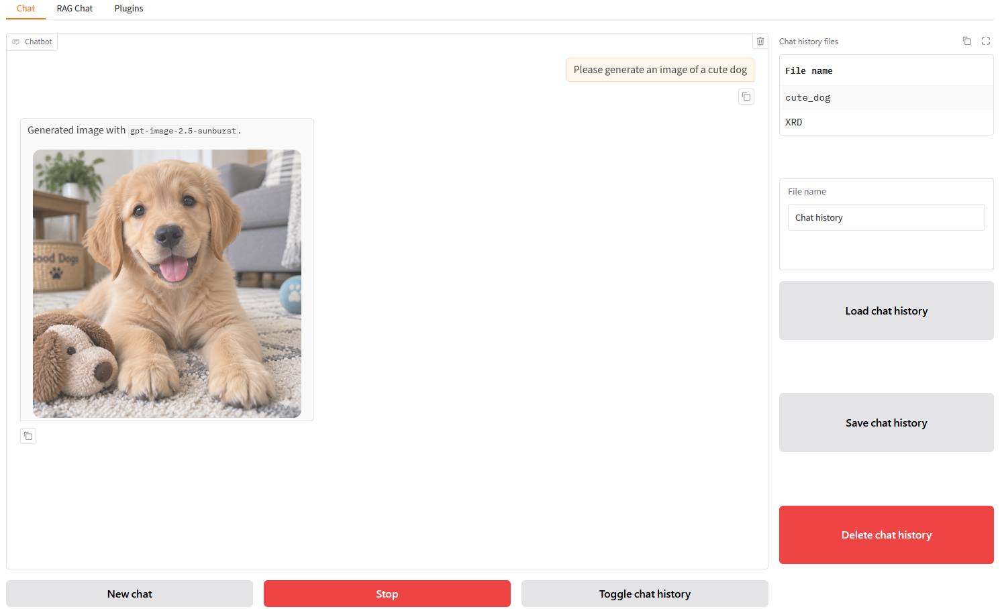
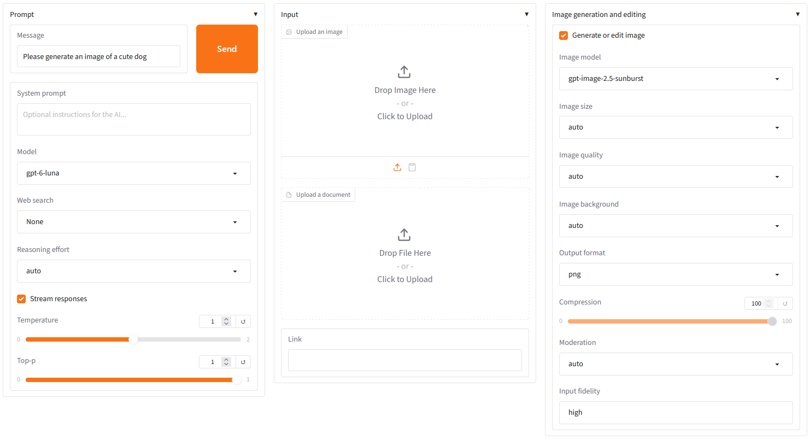

# OpenAI Chat and RAG Chat

A local Gradio app for chatting with OpenAI models and working with your documents.
Runs on Windows, macOS, and Linux with Python 3.10+.

- **Chat:** conversations, attachments, web search, LaTeX, image generation, and saved history.
- **RAG Chat:** reusable document workspaces, answers with source references, document previews, and Studio tools.
- **Plugins:** enable or disable the bundled tools and check their dependencies.

Both chat tabs default to `gpt-6-luna`. Image generation defaults to
`gpt-image-2.5-sunburst`; choose another available model in the interface.





## Installation

Clone the repository:

```sh
git clone https://github.com/phatdatnguyen/openai-gradio-chatbot
cd openai-gradio-chatbot
```

Create and activate a virtual environment.

**Windows PowerShell:**

```powershell
python -m venv chatbot-env
.\chatbot-env\Scripts\Activate.ps1
```

If activation is restricted, use `chatbot-env\Scripts\python.exe` instead of
`python` below. For Command Prompt, activate with `chatbot-env\Scripts\activate.bat`.

**macOS/Linux:**

```sh
python3 -m venv chatbot-env
. chatbot-env/bin/activate
```

Install dependencies:

```sh
python -m pip install -r requirements.txt
python -m pip check
```

Set your API key in the same terminal:

```powershell
# Windows PowerShell
$env:OPENAI_API_KEY = "<your API key>"
```

```sh
# macOS/Linux
export OPENAI_API_KEY="<your API key>"
```

Alternatively, create `chatbot/api_key.py` containing `API_KEY = "<your API key>"`.
This file is ignored by Git. The environment variable takes precedence.

## Start the app

```sh
python webui.py
```

Or use `start_webui.bat` on Windows and `sh start_webui.sh` on macOS/Linux.
Open the local URL printed in the terminal, normally `http://127.0.0.1:7860`.
Stop the app with `Ctrl+C`. After updating, restart it and refresh your browser.

The interface and local previews work without an API key. Indexing and generation
use your OpenAI account and incur API charges.

## RAG Chat

First, start the Qdrant vector database. With Docker running, execute:

```sh
docker compose up -d
```

For a small library without Docker, follow the [embedded database setup](docs/rag-guide.md#start-the-vector-database).

1. Select a **Workspace** to open it, or type a new name and press Enter.
2. Upload files under **Sources**, adjust their display filenames if needed, and
   click **Index documents**. Enable vision extraction for scanned pages or images.
3. Check the sources you want to use, then ask a question. The same selection is
   used by Studio tools. Web search is optional and starts off.
4. Open an answer's **References** to inspect its supporting passage. Select a
   source in **Document viewer** to preview it immediately.
5. Save conversations before switching workspaces. Each Studio tool automatically
   keeps its latest successful result and restores it when you return.

Supported sources include PDF, DOCX, XLS/XLSX, PPTX, CSV/TSV, HTML, Markdown, text,
and images. Convert legacy DOC/PPT files before indexing. Office is not required
for native extraction; optional local converters provide page and slide previews.

Workspaces live in `rag_chatbot/data/` and keep their sources, chats, and tool outputs
separate. Indexing sends extracted text to OpenAI; vision sends images, and answers
send the question and relevant passages. Review references when accuracy matters.

See the [RAG Chat guide](docs/rag-guide.md) for database options, source management,
previews, storage, and troubleshooting.

## Studio tools

| Tool | What it does |
|---|---|
| Summary | Creates a cited summary that you can edit and export. |
| Spreadsheet | Extracts fields into an editable table, with one row per document. |
| Presentation | Creates a slide deck with notes and editable PowerPoint export. |
| Graphics | Generates an illustration from a source-based visual brief. |
| Plot | Makes bar, line, or scatter charts with up to 10,000 points. |
| Mind Map | Organizes document topics into a visual tree. |
| Flashcards | Creates cards for local study and review. |
| Quizzes | Creates and scores multiple-choice questions; exports Aiken or Moodle XML. |
| Compare | Compares 2–8 documents side by side. |
| Evidence Check | Reviews claims against selected sources with quotations and explanations. |

Open a tool under RAG Chat's **Tools**, adjust its instructions, and generate.
Tools share the checked sources and Prompt model/reasoning settings. Use the
**Plugins** tab's Enabled checkboxes to manage availability.

For an Iris scatter plot, select only the CSV and ask for sepal length on the
x-axis, sepal width on the y-axis, colored by species. CSV/TSV plots read all rows
locally after one model request selects the columns. The table preview shows up
to 200 points; the chart and CSV/JSON exports retain all points.

See the [Studio tools guide](docs/studio-tools.md) for editing, export formats,
limits, and examples. Audio and video tools are outside the current scope.

## More information

- [RAG Chat guide](docs/rag-guide.md)
- [Studio tools guide](docs/studio-tools.md)
- [Development, tests, and backups](docs/development.md)


